06-network

Fluxo central de comunicação entre servidor e parties. Este nível reúne bootstrap, treino horizontal e treino vertical em uma visão única.

```mermaid
flowchart TD
    A[Dataset de entrada] --> B{partition ativado?}
    B -->|sim| C[Carrega dataset único e particiona localmente]
    B -->|não| D[Cada party carrega seu próprio dataset]
    C --> E{partition_mode}
    E -->|horizontal| F[Divide amostras entre as parties]
    E -->|vertical| G[Divide features entre as parties]
    E -->|hybrid| H[Divide amostras e depois features]
    D --> I[Subconjunto já separado por party]
    F --> J[Parties recebem todas as features e poucas amostras]
    G --> K[Parties recebem poucas features e todas as amostras]
    H --> L[Parties recebem recortes mistos do dataset]
    I --> M[Partições prontas para o treino]
    J --> M
    K --> M
    L --> M
    M --> N[Comunicação FedTree]
    N --> O[Party abre conexão com o servidor]
    O --> O1[Party envia PID]
    O1 --> O2[Servidor responde com Ready]
    O2 --> O3[Party solicita a barreira inicial]
    O3 --> O4[Servidor aguarda todas as parties saírem do estado anterior]
    O4 --> O5[Barreira liberada para o treino]
    O5 --> P[Modo, privacidade e bootstrap de mensagens]
    P --> P1[Coordenação inicial concluída]
    P1 --> P2{Modo operacional}
    P2 -->|horizontal| P3[Fluxo orientado a split por linhas]
    P2 -->|vertical| P4[Fluxo orientado a split por colunas]
    P2 -->|ensemble| P5[Fluxo de combinação de árvores]
    P3 --> Q{privacy_tech}
    P4 --> Q
    P5 --> Q
    Q -->|HE| R[PID 0 dispara HomoInit]
    R --> R1[Servidor prepara Paillier]
    R1 --> R2[Parties recebem a chave pública]
    R2 --> S[Preparação para o treino]
    Q -->|SA| T[Cada party gera DHPublicKey]
    T --> T1[Parties trocam DHPublicKeys]
    T1 --> T2[Parties derivam chaves compartilhadas]
    T2 --> T3[Parties trocam SANoises]
    T3 --> S
    Q -->|DP| U[DP: inicialização do ruído local]
    U --> S
    Q -->|none| V[Sem camada extra]
    V --> S
    S --> W{Modo de treino}

    W -->|horizontal| H1{Bootstrap horizontal}
    H1 --> H2{propose_split}
    H2 -->|server| H3[Party envia range das features]
    H3 --> H4[Servidor espera todas as parties]
    H4 --> H5[Servidor calcula cut points globais]
    H5 --> H6[Parties recebem a mesma base de discretização]
    H2 -->|party| H7[Party envia cut points locais]
    H7 --> H8[Servidor espera todas as parties]
    H8 --> H9[Servidor calcula cut points a partir das parties]
    H9 --> H10[Parties recebem a base de discretização]
    H6 --> H11[Início da rodada horizontal]
    H10 --> H11
    H11 --> H12[Party atualiza gradients locais]
    H12 --> H13[Party reduz os gradients em GHPair]
    H13 --> H14[Party envia GHPair ao servidor]
    H14 --> H15[Loop de árvores da rodada]
    H15 --> H16[Tree builder inicializado com gradients]
    H16 --> H17[Loop de níveis da árvore]
    H17 --> H18{SA ativo?}
    H18 -->|sim| H19[Party troca e decripta noises]
    H18 -->|não| H20[Segue sem ruído]
    H19 --> H21[Party calcula histograms, missing_gh e hist_fid]
    H20 --> H21
    H21 --> H22{privacy_tech}
    H22 -->|HE| H23[Party cifra histograms antes do envio]
    H22 -->|SA| H24[Party adiciona ruído antes do envio]
    H22 -->|none / dp| H25[Party envia histograms em claro]
    H23 --> H26[Party envia histograms e missing_gh]
    H24 --> H26
    H25 --> H26
    H26 --> H27[Party envia hist_fid do nível]
    H27 --> H28{PID 0 dispara calc tree?}
    H28 -->|sim| H29[Servidor calcula SplitPoint]
    H28 -->|não| H30[Parties aguardam SplitPoint]
    H29 --> H30
    H30 --> H31{Nível 0?}
    H31 -->|sim| H32[Party recebe RootNode]
    H31 -->|não| H33[Segue sem RootNode]
    H32 --> H34[Party atualiza árvore e ins2node_id]
    H33 --> H34
    H34 --> H35{Pode continuar dividindo?}
    H35 -->|sim| H17
    H35 -->|não| H36[Party faz prune local]
    H36 --> H37[Party atualiza a predição em treino]
    H37 --> H38[Party copia a árvore final da rodada]
    H38 --> H39[Party calcula score local]
    H39 --> H40[Party chama GetAvgScore e envia Score]
    H40 --> H41[Servidor devolve Score médio]
    H41 --> H42{Ainda há rounds?}
    H42 -->|sim| H11
    H42 -->|não| H43[Party salva modelo localmente]

    W -->|vertical| V1{Bootstrap vertical}
    V1 -->|HE| V2[PID 0 dispara HomoInit]
    V1 -->|SA| V3[Parties trocam DHPublicKey/DHPublicKeys e SANoises]
    V1 -->|none / dp| V4[Sem bootstrap criptográfico]
    V2 --> V5[Parties sem label recebem Paillier]
    V3 --> V6[Chaves compartilhadas para agregação segura]
    V4 --> V7[Início do round vertical]
    V5 --> V7
    V6 --> V7
    V7 --> V8{PID 0 dispara atualização de gradients?}
    V8 -->|sim| V9[Servidor atualiza gradients em GHPair]
    V8 -->|não| V10[Parties obtêm gradients em GHPair/GHBatch/GHEncBatch]
    V9 --> V10
    V10 --> V11{Bootstrap de gradients: label ou cliente sem label?}
    V11 -->|has_label| V12[Party atualiza gradients localmente em GHPair]
    V11 -->|no_label + HE| V13[Party recebe gradient batches cifrados em GHEncBatch]
    V11 -->|no_label + normal| V14[Party recebe gradient batches em GHBatch]
    V12 --> V15[Loop de árvores na rodada]
    V13 --> V15
    V14 --> V15
    V15 --> V16{PID 0 dispara build init?}
    V16 -->|sim| V17[Servidor inicializa a árvore com GHPair]
    V16 -->|não| V18[Parties inicializam a árvore com GHPair]
    V17 --> V19[Raiz da árvore pronta]
    V18 --> V19
    V19 --> V20[Loop de níveis da árvore]
    V20 --> V21[Party calcula histograms em GHPair e fid]
    V21 --> V22[Party envia GHPair/FIDBatch]
    V22 --> V23{PID 0 dispara aggregate?}
    V23 -->|sim| V24[Servidor agrega e devolve BestInfo]
    V23 -->|não| V25[Party recebe BestInfo]
    V24 --> V25
    V25 --> V26{Essa party venceu o split?}
    V26 -->|sim| V27[Party atualiza TreeNode e envia Node/NodeArray]
    V26 -->|não| V28[Party aguarda sincronização]
    V27 --> V29[Servidor recebe e armazena Node/NodeArray]
    V28 --> V30[Servidor recebe e armazena Node/NodeArray]
    V29 --> V31[Servidor distribui Node sincronizados]
    V30 --> V31
    V31 --> V32[Party recebe Node sincronizados]
    V32 --> V33{Pode continuar dividindo o nó?}
    V33 -->|sim| V20
    V33 -->|não| V34[Prune local da árvore]
    V34 --> V35[Atualização da predição em treino]
    V35 --> V36{PID 0 dispara print score?}
    V36 -->|sim| V37[Servidor imprime Score]
    V36 -->|não| V38[Seguir sem imprimir score]
    V37 --> V39{Ainda há árvores na rodada?}
    V38 --> V39
    V39 -->|sim| V15
    V39 -->|não| V40{Ainda há rounds?}
    V40 -->|sim| V7
    V40 -->|não| V41[Party salva modelo localmente]

    H43 --> Z[Party salva modelo localmente e persiste GBDT]
    V41 --> Z
    Z --> X[Party chama StopServer]
    X --> X1[Party envia tot, comm e enc]
    X1 --> Y[Servidor registra tempos individuais]
    Y --> Y1[Servidor marca a party como stoppable]
    Y1 --> W[Servidor espera as demais parties]
    W --> W1[Servidor calcula estatísticas finais]
    W1 --> U[Encerramento do servidor]
```

### Detalhe Da Particao

- `Particiona por linhas`: embaralha os índices das amostras e distribui blocos de linhas entre as parties. Cada party fica com um subconjunto de amostras e todas as features.
- `Particiona por linhas`: os índices de amostras viram lotes por party, preservando todas as features para cada uma.
- `Particiona por colunas`: divide as features entre as parties. Cada party fica com um subconjunto de colunas e todas as amostras.
- `Particiona por linhas e colunas`: primeiro divide as amostras em grupos horizontais e depois divide as features em grupos verticais dentro de cada grupo horizontal.
- `Cada party carrega seu próprio dataset`: não há particionamento automático. O arquivo já vem separado por party.
- `Partições prontas para o treino`: o dataset já está na forma que cada modo de treino espera antes de qualquer comunicação de protocolo.

### Mensagens No Horizontal

- `PID` e `Ready`: identificam a party e liberam a barreira inicial antes do treino.
- `BeginBarrier`: mantém as parties sincronizadas até que todas estejam prontas e fora do estado de parada anterior.
- `Modo operacional`: define se o protocolo segue caminho horizontal, vertical ou de ensemble.
- `privacy_tech`: escolhe se o bootstrap precisa de HE, SA, DP ou nenhuma camada extra.
- `propose_split`: decide quem propõe a discretização inicial das features.
- `Paillier`: chave pública distribuída quando o modo usa HE.
- `DHPublicKey` e `DHPublicKeys`: base para derivar chaves compartilhadas no modo SA.
- `SANoises`: ruídos trocados entre parties no bootstrap de agregação segura.
- `GHPair`: resumo agregado de gradientes e hessians que alimenta a construção da árvore.
- `SplitPoint`: resposta do servidor com os cortes escolhidos para cada nó do nível atual.
- `Node` e `NodeArray`: estrutura sincronizada entre parties depois que um split é aplicado.
- `FID` e `FIDBatch`: identificam quais features participam de cada histograma.
- `Score`: valor trocado no fim da rodada para calcular a média entre as parties.
- `StopServer`: finaliza a execução e leva as métricas de tempo para o servidor.
- `tot`, `comm` e `enc`: métricas enviadas no encerramento para consolidar os tempos do treino.

