<details>
<summary>07-cpn-hierarchy</summary>

Hierarquia inicial para a modelagem do FedTree em CPN Tools. Este arquivo organiza o fluxo em páginas substitutas, com foco em criação das parties e na comunicação cliente-servidor antes das fases de treino.

## Objetivo

Estruturar o modelo para que cada página represente uma fase observável do protocolo, evitando misturar no mesmo nível:

- criação e inicialização das parties
- conexão e handshake cliente-servidor
- barreira inicial e prontidão
- bootstrap de privacidade
- carregamento e particionamento de dados
- treino horizontal
- treino vertical
- encerramento

## Como Visualizar

A melhor forma de representar isso no CPN Tools é em duas camadas:

- **Camada macro**: páginas substitutas que representam fases inteiras do protocolo.
- **Camada de detalhe**: subpáginas que só aparecem onde existe comunicação ou sincronização real.

Visualmente, isso fica mais claro se a página raiz mostrar apenas o fluxo principal e cada bloco crítico for expandido em subpáginas.

## Regra De Interface CPN

Para este documento, `IN` e `OUT` representam a interface formal de cada página substituta:

- `IN` é o lugar de entrada da subpágina.
- `OUT` é o lugar de saída da subpágina.
- A subpágina consome o token recebido em `IN`, executa suas transições internas e devolve o estado final em `OUT`.
- Estados usados como `IN` ou `OUT` devem existir como lugares globais ou ser declarados como lugares locais da própria subpágina.
- Uma subpágina não deve introduzir um estado de saída sem explicar onde esse estado é consumido no nível superior.

## Proposta De Hierarquia

```text
P0 - Fluxo Geral
├── P1 - Criação das Parties
│   ├── P1.1 - Criação do canal e identificação
│   ├── P1.2 - Carregamento de datasets
│   ├── P1.3 - Particionamento local opcional
│   └── P1.4 - Inicialização do estado da party
├── P2 - Comunicação Cliente-Servidor
├── P3 - Barreiras e Prontidão
├── P4 - Bootstrap de Privacidade
├── P5 - Partição e Carregamento
├── P6 - Treino Horizontal
├── P7 - Treino Vertical
├── P8 - Modo Ensemble ou Solo
└── P9 - Encerramento
```

## Fluxo Macro Recomendado

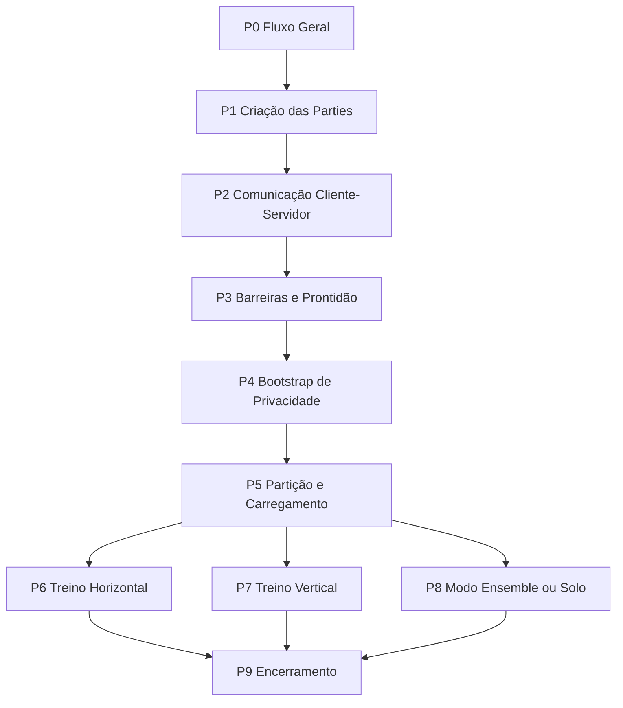

## Fluxo Por Página

<details>
<summary>P0 - Fluxo Geral</summary>

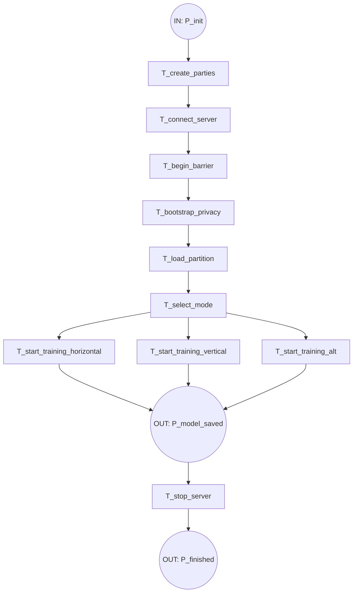

</details>

<details>
<summary>P1 - Criação das Parties</summary>

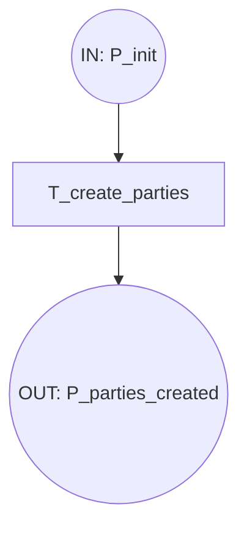

</details>

<details>
<summary>P2 - Comunicação Cliente-Servidor</summary>

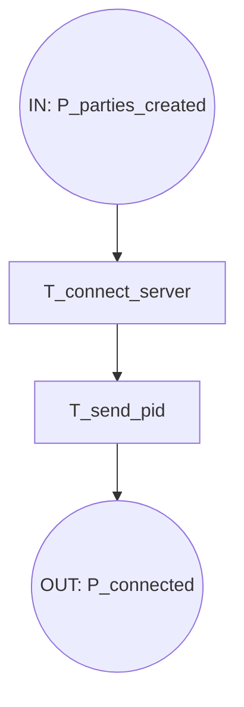

</details>

<details>
<summary>P3 - Barreiras e Prontidão</summary>

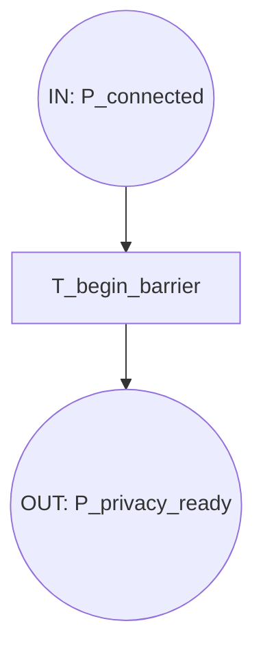

</details>

<details>
<summary>P4 - Bootstrap de Privacidade</summary>

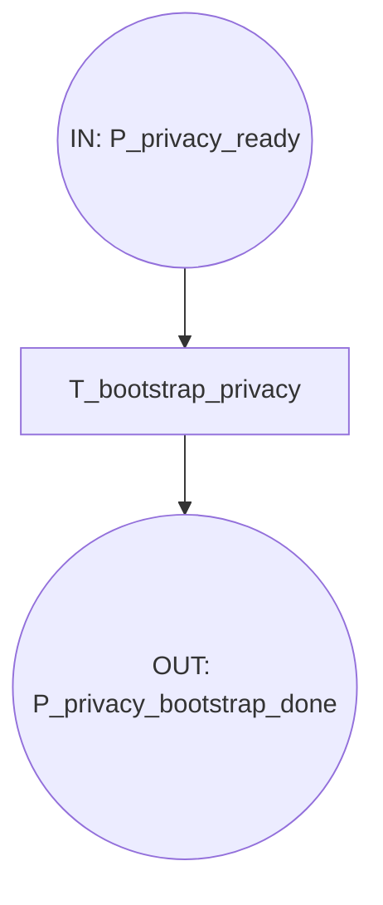

</details>

<details>
<summary>P5 - Partição e Carregamento</summary>

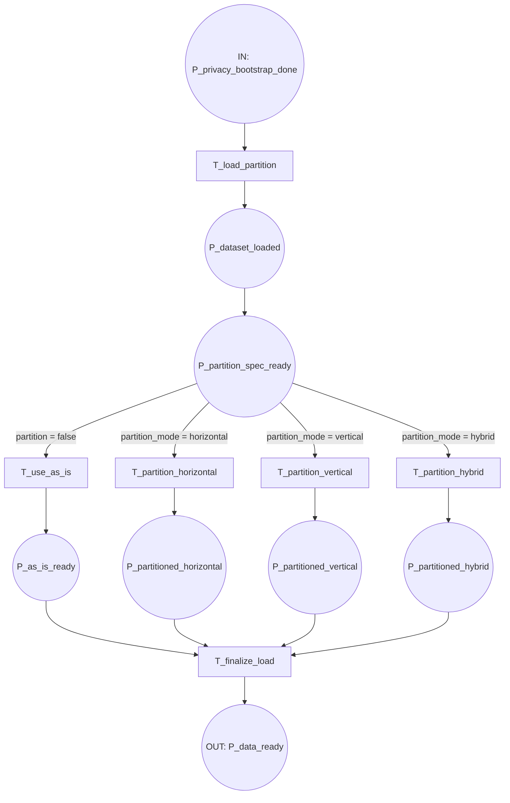

</details>

<details>
<summary>P6 - Treino Horizontal</summary>

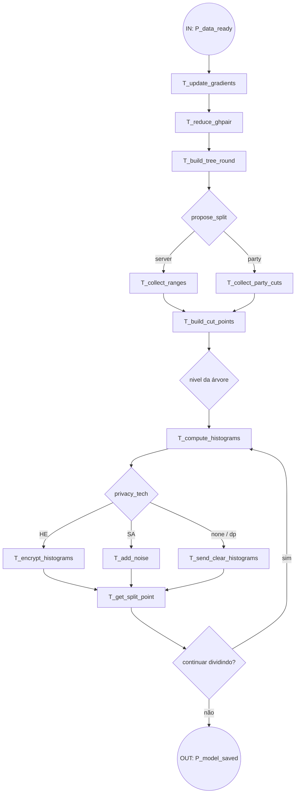

</details>

<details>
<summary>P7 - Treino Vertical</summary>

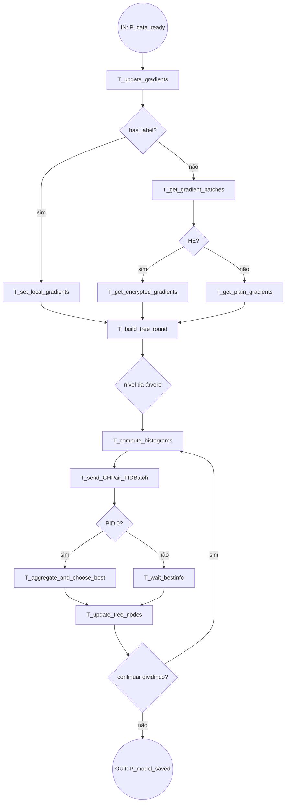

</details>

<details>
<summary>P8 - Modo Ensemble ou Solo</summary>

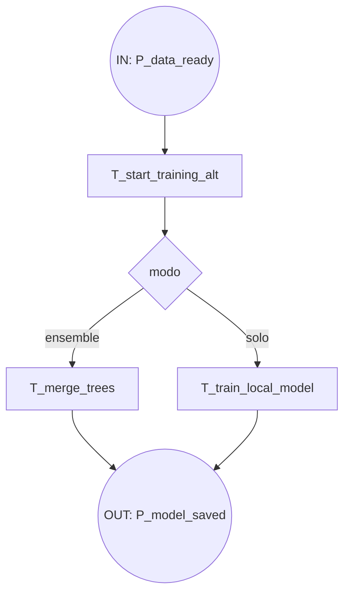

</details>

<details>
<summary>P9 - Encerramento</summary>

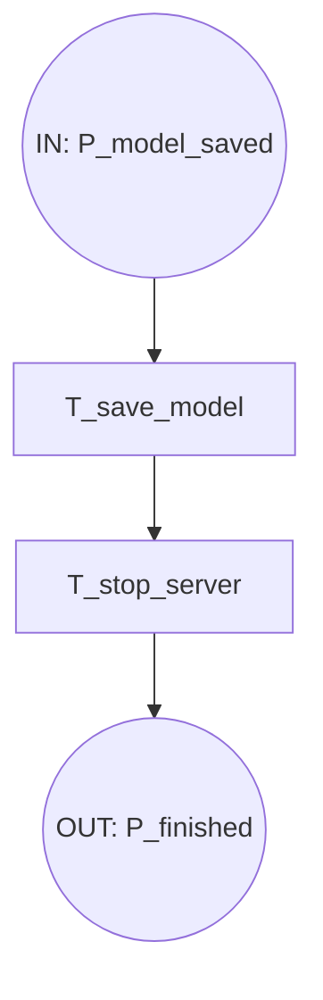

</details>

## Hierarquia De Páginas E Subpáginas

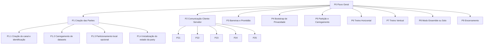

## Papel De Cada Página

- `P0 - Fluxo Geral`: decide o caminho macro do sistema e conecta as fases principais.
- `P1 - Criação das Parties`: instancia cada party local e prepara seu estado antes da sincronização.
- `P1.1 - Criação do canal e identificação`: representa a criação do `DistributedParty` e a associação com o servidor.
- `P1.2 - Carregamento de datasets`: representa a carga do dataset local e do dataset de teste opcional.
- `P1.3 - Particionamento local opcional`: representa a divisão em subconjuntos quando `partition` está ativo.
- `P1.4 - Inicialização do estado da party`: representa `init` ou `vertical_init` conforme o modo.
- `P2 - Comunicação Cliente-Servidor`: expande `T_connect_server`, `T_send_pid` e `T_receive_ready` e modela o handshake inicial com o servidor.
- `P3 - Barreiras e Prontidão`: expande `T_begin_barrier` e libera a prontidão para a fase seguinte.
- `P4 - Bootstrap de Privacidade`: seleciona e prepara `HE`, `SA`, `DP` ou `none`.
- `P5 - Partição e Carregamento`: expande `T_load_partition`, carrega os dados e detalha a decisão de particionamento.
- `P6 - Treino Horizontal`: expande `T_start_training_horizontal` e cobre gradients, cut points, histogramas, split e prune.
- `P7 - Treino Vertical`: expande `T_start_training_vertical` e representa o ciclo vertical completo, incluindo gradients, histogramas, agregação e atualização de nós.
- `P8 - Modo Ensemble ou Solo`: expande `T_start_training_alt` e separa os ramos alternativos do executável, se forem modelados.
- `P9 - Encerramento`: cobre salvamento do modelo, solicitação de `StopServer` e finalização global.

## Critério Para Criar Nova Página

Uma nova página só deve ser criada quando ocorrer pelo menos uma destas situações:

- a fase tiver um laço próprio de comunicação;
- houver sincronização explícita entre party e servidor;
- o estado precisar ser separado para evitar poluição do modelo superior;
- a fase tiver comportamento distinto por modo operacional.

Se a etapa ainda não tiver troca de mensagens nem decisão própria, ela deve permanecer como transição simples dentro da página pai.

## Mapeamento CPN Das Páginas

- `P0 - Fluxo Geral`: compõe a árvore completa de execução.
- `P1 - Criação das Parties`: entrega `P_parties_created`.
- `P2 - Comunicação Cliente-Servidor`: entrega `P_connected`.
- `P3 - Barreiras e Prontidão`: entrega `P_privacy_ready`.
- `P4 - Bootstrap de Privacidade`: entrega `P_privacy_bootstrap_done`.
- `P5 - Partição e Carregamento`: entrega `P_data_ready`.
- `P6 - Treino Horizontal`: entrega `P_model_saved`.
- `P7 - Treino Vertical`: entrega `P_model_saved`.
- `P8 - Modo Ensemble ou Solo`: entrega `P_model_saved`.
- `P9 - Encerramento`: entrega `P_finished`.

## Conteúdo De Cada Página E Subpágina

### `P0 - Fluxo Geral`

- IN: `P_init`
- OUT: `P_finished`
- Fluxo macro que liga todas as páginas.

### `P1 - Criação das Parties`

- IN: `P_init`
- OUT: `P_parties_created`
- Fluxo: `P_init -> T_create_parties -> P_context_ready -> T_setup_logs -> P_logs_ready -> T_read_params -> P_params_ready -> T_define_num_parties -> P_count_ready -> T_load_dataset -> P_data_loaded -> T_adjust_classes -> P_classes_ready -> T_partition_local -> P_data_partitioned -> T_init_party -> P_parties_created`
- Função: materializar parties, preparar logs, parâmetros, dados, particionamento local e inicialização

### `P2 - Comunicação Cliente-Servidor`

- IN: `P_parties_created`
- OUT: `P_connected`
- Fluxo: `P_parties_created -> T_connect_server -> P_channel_open -> T_send_pid -> P_pid_sent -> T_receive_ready -> P_connected`
- Função: estabelecer a comunicacao inicial, trocar o PID e receber `Ready`

### `P3 - Barreiras e Prontidão`

- IN: `P_connected`
- OUT: `P_privacy_ready`

### `P4 - Bootstrap de Privacidade`

- IN: `P_privacy_ready`
- OUT: `P_privacy_bootstrap_done`

### `P5 - Partição e Carregamento`

- IN: `P_privacy_bootstrap_done`
- OUT: `P_data_ready`

### `P6 - Treino Horizontal`

- IN: `P_data_ready`
- OUT: `P_model_saved`

### `P7 - Treino Vertical`

- IN: `P_data_ready`
- OUT: `P_model_saved`

### `P8 - Modo Ensemble ou Solo`

- IN: `P_data_ready`
- OUT: `P_model_saved`

### `P9 - Encerramento`

- IN: `P_model_saved`
- OUT: `P_finished`

## Esboço De Lugares E Transições

Para CPN Tools, a página raiz deve representar o estado global do protocolo. Nesse nível, o mais útil é separar:

- **lugares** como estados estáveis;
- **transições** como eventos que mudam de fase;
- **subpáginas** como blocos que detalham uma transição complexa.

### Lugares Globais Sugeridos

- `P_init` - sistema criado, ainda sem parties prontas.
- `P_channel_open` - canal cliente-servidor aberto.
- `P_parties_created` - parties instanciadas localmente.
- `P_pid_sent` - identificador da party enviado ao servidor.
- `P_connected` - canal cliente-servidor aberto.
- `P_privacy_ready` - bootstrap de privacidade concluído.
- `P_privacy_bootstrap_done` - bootstrap de privacidade finalizado.
- `P_data_ready` - dados carregados e preparados.
- `P_data_loaded` - dados carregados pela party.
- `P_data_partitioned` - dados particionados localmente.
- `P_mode_selected` - modo operacional definido.
- `P_model_saved` - modelo persistido.
- `P_session_closed` - sessão RPC encerrada.
- `P_server_stop_requested` - encerramento solicitado ao servidor.
- `P_finished` - protocolo encerrado.

### Transições Globais Sugeridas

- `T_create_parties` - cria e inicializa as parties.
- `T_connect_server` - abre o canal e estabelece a associação com o servidor.
- `T_send_pid` - party identifica-se ao servidor.
- `T_receive_ready` - servidor devolve prontidão.
- `T_begin_barrier` - libera a fase inicial do treino.
- `T_bootstrap_privacy` - executa `HE`, `SA`, `DP` ou nenhum bootstrap.
- `T_load_partition` - carrega ou particiona os dados.
- `T_select_mode` - define horizontal, vertical, ensemble ou solo.
- `T_save_model` - persiste o modelo treinado.
- `T_stop_server` - solicita encerramento ao servidor.
- `T_finalize` - encerra completamente a execução.

### Relação Entre Página E Fluxo

- `P0 - Fluxo Geral` deve conter os lugares globais e as transições macro.
- `P1 - Criação das Parties` detalha `T_create_parties`.
- `P2 - Comunicação Cliente-Servidor` detalha `T_connect_server`, `T_send_pid` e `T_receive_ready`.
- `P3 - Barreiras e Prontidão` detalha `T_begin_barrier`.
- `P4 - Bootstrap de Privacidade` detalha `T_bootstrap_privacy`.
- `P5 - Partição e Carregamento` detalha `T_load_partition`.
- `P6` detalha `T_start_training_horizontal`.
- `P7` detalha `T_start_training_vertical`.
- `P8` detalha `T_start_training_alt`.
- `P9 - Encerramento` detalha `T_save_model`, `T_stop_server` e `T_finalize`.

## Visao Por Pagina

### `P0 - Fluxo Geral`

- IN: `P_init`
- OUT: `P_finished`
- Fluxo: `P_init -> T_create_parties -> P_parties_created -> T_connect_server -> P_connected -> T_begin_barrier -> P_privacy_ready -> T_bootstrap_privacy -> P_privacy_bootstrap_done -> T_load_partition -> P_data_ready -> T_select_mode -> P_mode_selected -> T_start_training_horizontal / T_start_training_vertical / T_start_training_alt -> P_model_saved -> T_stop_server -> P_server_stop_requested -> T_finalize -> P_finished`
- Subpaginas: `P1`, `P2`, `P3`, `P4`, `P5`, `P6`, `P7`, `P8`, `P9`
- Função: página raiz com o estado global do protocolo

### `P1 - Criação das Parties`

- IN: `P_init`
- OUT: `P_parties_created`
- Fluxo: `P_init -> T_create_parties -> P_parties_created`
- Subpaginas: `P1.1`, `P1.2`, `P1.3`, `P1.4`
- Função: materializar parties e preparar o estado local

### `P2 - Comunicação Cliente-Servidor`

- IN: `P_parties_created`
- OUT: `P_connected`
- Fluxo: `P_parties_created -> T_connect_server -> P_channel_open -> T_send_pid -> P_pid_sent -> T_receive_ready -> P_connected`
- Função: estabelecer a comunicação inicial, trocar o PID e receber `Ready`

### `P3 - Barreiras e Prontidão`

- IN: `P_connected`
- OUT: `P_privacy_ready`
- Fluxo: `P_connected -> T_begin_barrier -> P_privacy_ready`
- Função: aguardar a barreira inicial e entregar prontidão para o bootstrap de privacidade

### `P4 - Bootstrap de Privacidade`

- IN: `P_privacy_ready`
- OUT: `P_privacy_bootstrap_done`
- Fluxo: `P_privacy_ready -> T_bootstrap_privacy -> P_privacy_bootstrap_done`
- Função: preparar HE, SA, DP ou nenhum mecanismo

### `P5 - Partição e Carregamento`

- IN: `P_privacy_bootstrap_done`
- OUT: `P_data_ready`
- Fluxo: `P_privacy_bootstrap_done -> T_load_partition -> P_dataset_loaded -> P_partition_spec_ready -> T_use_as_is / T_partition_horizontal / T_partition_vertical / T_partition_hybrid -> T_finalize_load -> P_data_ready`
- Função: carregar os dados, avaliar a partição e liberar o treino no formato correto

### `P6 - Treino Horizontal`

- IN: `P_data_ready`
- OUT: `P_model_saved`
- Fluxo: `P_data_ready -> T_update_gradients -> P_gradients_ready -> T_reduce_ghpair -> P_ghpair_ready -> T_build_tree_round -> P_round_ready -> T_collect_ranges / T_collect_party_cuts -> P_cutpoints_ready -> T_compute_histograms -> P_histograms_ready -> T_encrypt_histograms / T_add_noise / T_send_clear_histograms -> P_histograms_sent -> T_get_split_point -> P_split_received -> T_prune_and_score -> P_model_saved`
- Função: detalhar o ciclo horizontal completo, da atualização dos gradients até a poda e o score

### `P7 - Treino Vertical`

- IN: `P_data_ready`
- OUT: `P_model_saved`
- Fluxo: `P_data_ready -> T_start_training_vertical -> P_model_saved`
- Função: detalhar o ciclo vertical

### `P8 - Modo Ensemble ou Solo`

- IN: `P_data_ready`
- OUT: `P_model_saved`
- Fluxo: `P_data_ready -> T_start_training_alt -> P_model_saved`
- Função: manter os ramos alternativos do executável

### `P9 - Encerramento`

- IN: `P_model_saved`
- OUT: `P_finished`
- Fluxo: `P_model_saved -> T_save_model -> P_session_closed -> T_stop_server -> P_server_stop_requested -> T_finalize -> P_finished`
- Função: persistir o modelo, solicitar o stop do servidor e finalizar completamente a execução.

## Regra De Modelagem

- Cada `substitution transition` deve corresponder a uma fase completa do protocolo.
- As páginas internas devem expor apenas o estado necessário para sincronização.
- O modelo deve priorizar quem envia, quem aguarda, quem agrega e quem libera a próxima etapa.
- Detalhes numéricos do treinamento devem ser evitados enquanto não forem necessários para a propriedade analisada.

## Estrutura De Tokens

Sugestão inicial de cores úteis:

- `PartyState`
- `ServerState`
- `Mode`
- `PrivacyTech`
- `BarrierToken`
- `GradientMsg`
- `HistogramMsg`
- `SplitMsg`
- `NodeMsg`
- `StopMsg`

## Próximos Refinamentos

Depois de validar a hierarquia básica, as páginas que mais provavelmente vão precisar de detalhamento são:

- `P1 - Criação das Parties`
- `P2 - Comunicação Cliente-Servidor`
- `P3 - Barreiras e Prontidão`
- `P6 - Treino Horizontal`
- `P7 - Treino Vertical`

</details>
