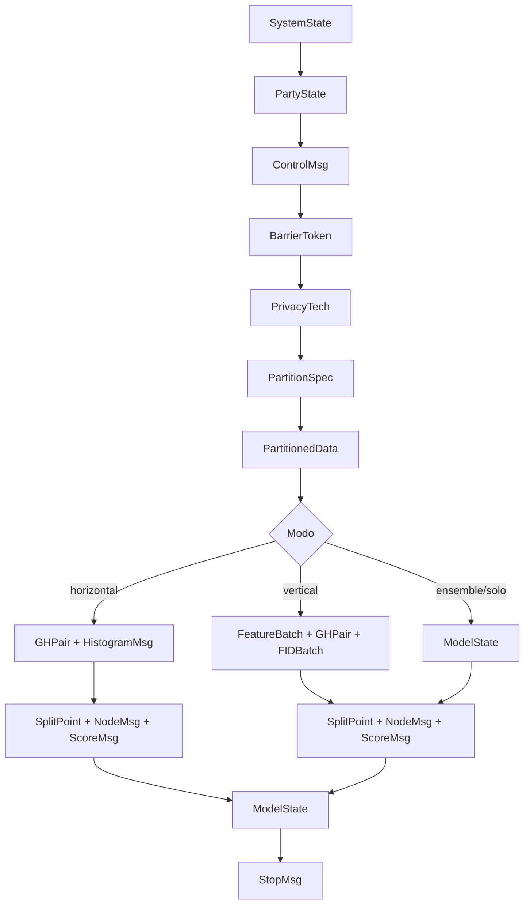

08-data-flow-types

Visão de engenharia reversa do FedTree com foco no fluxo dos dados e na tipagem conceitual dos tokens que circulam entre servidor e parties. Este texto parte do fluxo geral do protocolo e destaca onde os dados mudam de forma, quem os produz, quem os consome e em que ponto a comunicação passa a depender do modo de treino.

## Objetivo

Explicar o FedTree como um sistema de passagem de estados e mensagens, não apenas como uma sequência de etapas. A ideia é enxergar:

- quais informações entram no sistema;
- como essas informações são carregadas, particionadas e sincronizadas;
- quais mensagens são comuns aos dois modos de treino;
- onde o fluxo horizontal e o vertical se separam;
- por que o vertical merece mais detalhe nesta visão, sem duplicar demais o texto.

## Leitura Geral

O protocolo pode ser lido em cinco blocos:

1. entrada e preparação do ambiente;
2. criação e identificação das parties;
3. handshake com o servidor e sincronização inicial;
4. bootstrap de privacidade e preparação dos dados;
5. ciclo de treino e encerramento.

Os dados mudam de tipo ao longo dessas fases. No começo, o sistema lida com parâmetros, caminhos de arquivo e descrições de execução. Em seguida, esses dados viram estados locais de party, tokens de coordenação, mensagens de gradientes, histogramas, cortes de árvore, nós sincronizados e, por fim, modelo persistido e métricas de encerramento.

## Tipos Conceituais

Os tipos abaixo não são uma implementação literal de `colorset` do CPN Tools, mas uma forma de documentar a semântica dos tokens do projeto.

### Tipos de controle

- `SystemState`: estado global do executável, antes da criação das parties.
- `PartyState`: estado local de cada party depois da inicialização.
- `ServerState`: estado de coordenação mantido pelo servidor.
- `Mode`: define o ramo operacional, como horizontal, vertical, ensemble ou solo.
- `PrivacyTech`: define se o protocolo usa `HE`, `SA`, `DP` ou `none`.
- `BarrierToken`: token de sincronização usado na barreira inicial e em esperas de rodada.

### Tipos de dados de treino

- `DatasetBundle`: conjunto inicial com treino e, quando existir, teste opcional.
- `PartitionSpec`: descrição de como o dataset foi dividido.
- `PartitionedData`: subconjunto efetivamente entregue a uma party.
- `FeatureBatch`: lote de features usado em etapas verticais.
- `GHPair`: resumo de gradients e hessians usado na construção da árvore.
- `GHBatch`: gradients em lote para parties sem label.
- `GHEncBatch`: gradients cifrados quando `HE` está ativo.
- `HistogramMsg`: histograma local ou agregado enviado ao servidor.
- `FIDBatch`: conjunto de identificadores de features usados no cálculo dos histogramas.
- `SplitPoint`: decisão do corte escolhido para um nó.
- `NodeMsg`: nó de árvore atualizado e sincronizado entre parties.
- `ScoreMsg`: score local ou médio usado para decidir continuidade.

### Tipos de privacidade e comunicação

- `HomoKey`: chave pública usada no fluxo com `HE`.
- `DHPublicKey`: chave pública usada no bootstrap de `SA`.
- `SANoise`: ruído trocado entre parties no modo de agregação segura.
- `DPNoise`: ruído local usado quando o fluxo segue com `DP`.
- `ControlMsg`: mensagem curta de coordenação como `PID`, `Ready` e `BeginBarrier`.
- `StopMsg`: mensagem de encerramento e consolidação de tempos.

## Fluxo Macro Dos Dados

## Entrada E Preparação

O fluxo começa em `SystemState`, que reúne os parâmetros lidos pelo `main`, o número de parties, a configuração de logs, o modo de execução e os caminhos de dados. Nessa fase, o dado ainda é administrativo. Ele descreve o ambiente, não o treino.

Depois disso, o sistema produz `PartyState`, que é o primeiro tipo realmente local. Cada party passa a carregar seu próprio contexto: `pid`, conexões, dataset, modo de treino e estado de sincronização.

Nesse ponto, ainda não existe comunicação de treinamento. O que existe é preparação para que a party consiga se identificar ao servidor e entrar na barreira inicial.

## Comunicação E Sincronização

A troca com o servidor começa com `ControlMsg`.

Os primeiros tokens desse bloco são simples:

- `PID`, para identificação;
- `Ready`, para confirmar disponibilidade;
- `BeginBarrier`, para alinhar o início do treino;
- `StopServer`, para encerrar a sessão.

Esses tokens não carregam conteúdo de treino. Eles carregam **coordenação**. Em engenharia reversa, isso importa porque o FedTree não começa pelo gradiente; ele começa por uma negociação de presença, prontidão e liberação.

O `BarrierToken` separa o que é apenas conectado do que está realmente apto a treinar. Sem essa liberação, o fluxo ainda está preso à fase de preparação.

## Privacidade

A camada de privacidade pode introduzir três formas principais de transformação:

- `HomoKey`, quando o fluxo usa `HE`;
- `SANoise` e `DHPublicKey`, quando o fluxo usa `SA`;
- `DPNoise`, quando o fluxo usa `DP`.

O ponto importante aqui é que a privacidade não muda só a criptografia. Ela muda o tipo da mensagem que circula depois da sincronização inicial.

Exemplo:

- sem privacidade, o sistema pode enviar `HistogramMsg` em claro;
- com `HE`, o mesmo conteúdo pode virar `GHEncBatch` ou histograma cifrado;
- com `SA`, os dados passam por troca de ruído e compartilham chaves derivadas;
- com `DP`, o dado continua local, mas é perturbado antes de circular.

## Partição E Carregamento

Depois da privacidade, o sistema decide se os dados já estão prontos ou se ainda precisam ser particionados.

Aqui entram:

- `DatasetBundle`, quando o arquivo ainda está no estado bruto;
- `PartitionSpec`, quando o sistema precisa decidir se a divisão será horizontal, vertical ou híbrida;
- `PartitionedData`, quando o dado já foi recortado para a party;
- `FeatureBatch`, quando a partição vertical precisa separar colunas.

Essa parte é importante porque o tipo do dado define o restante do protocolo. Se o fluxo estiver em horizontal, a unidade principal é amostra. Se estiver em vertical, a unidade principal é feature.

## Treino Horizontal

O horizontal é o caminho mais direto de leitura: as parties compartilham a mesma estrutura de features e dividem amostras.

Fluxo resumido:

1. a party atualiza gradients;
2. esses gradients viram `GHPair`;
3. o servidor recebe o resumo;
4. a rodada cria histogramas por nível;
5. os histogramas são protegidos conforme `PrivacyTech`;
6. o servidor escolhe `SplitPoint`;
7. a party atualiza a árvore e calcula score;
8. o ciclo repete até o prune final.

Tipos mais relevantes no horizontal:

- `GHPair`
- `HistogramMsg`
- `SplitPoint`
- `NodeMsg`
- `ScoreMsg`

Esse ramo existe e precisa ser documentado porque representa o caminho em que o protocolo trabalha com agregação sobre amostras. Mas, para manter a documentação controlada, ele pode ficar mais resumido do que o vertical.

## Treino Vertical

O vertical é o ramo que melhor mostra a lógica de coordenação do FedTree, porque ele exige mais troca de estado entre parties.

Fluxo resumido:

1. o servidor ou a party de coordenação distribui gradients;
2. as parties sem label recebem `GHBatch` ou `GHEncBatch`;
3. o treino entra no laço de árvores por rodada;
4. cada nível calcula `HistogramMsg` junto com `FIDBatch`;
5. as parties enviam os resultados ao servidor;
6. o servidor agrega, escolhe `SplitPoint` e devolve `BestInfo`;
7. a party dona do split atualiza `NodeMsg`;
8. as demais parties aguardam sincronização;
9. o processo continua até o prune e a atualização da predição.

Tipos mais relevantes no vertical:

- `GHPair`
- `GHBatch`
- `GHEncBatch`
- `HistogramMsg`
- `FIDBatch`
- `SplitPoint`
- `NodeMsg`
- `ScoreMsg`

Esse é o ramo que mais revela a natureza federada do FedTree. Ele mostra que o sistema não apenas computa árvores, mas também negocia posse de informação: quem tem label, quem calcula histograma, quem agrega, quem vence o split e quem espera o estado consolidado.

## Por Que Dar Mais Peso Ao Vertical

Os dois modos existem e são parte do protocolo. O horizontal não é secundário. Mas, nesta documentação, faz sentido explorar mais o vertical porque ele concentra:

- mais mensagens distintas;
- mais sincronização entre parties;
- mais pontos de agregação;
- mais troca de estado global;
- mais tipos intermediários de dados.

Isso reduz a chance de o texto crescer demais sem perder a visão do sistema. O horizontal fica como ramo equivalente e documentado, mas o vertical funciona como referência principal para entender a mecânica de coordenação do FedTree.

## Encerramento

Depois do treino, o modelo vira `ModelState`, é salvo localmente e então o sistema produz `StopMsg` para encerrar a sessão com o servidor.

Nesse ponto, o fluxo já acumulou:

- dados de entrada;
- estados de party;
- mensagens de coordenação;
- objetos de privacidade;
- estruturas de árvore;
- scores e métricas;
- modelo final persistido.

Em termos de engenharia reversa, isso fecha o ciclo: o FedTree começa com uma descrição de execução, vira um sistema distribuído de troca de mensagens e termina com um modelo treinado e um protocolo encerrado.

## Resumo De Tipos Por Fase

- Entrada: `SystemState`
- Party: `PartyState`
- Coordenação: `ControlMsg`, `BarrierToken`
- Privacidade: `PrivacyTech`, `HomoKey`, `DHPublicKey`, `SANoise`, `DPNoise`
- Dados: `DatasetBundle`, `PartitionSpec`, `PartitionedData`, `FeatureBatch`
- Treino horizontal: `GHPair`, `HistogramMsg`, `SplitPoint`, `NodeMsg`, `ScoreMsg`
- Treino vertical: `GHBatch`, `GHEncBatch`, `HistogramMsg`, `FIDBatch`, `SplitPoint`, `NodeMsg`, `ScoreMsg`
- Saída: `ModelState`, `StopMsg`

