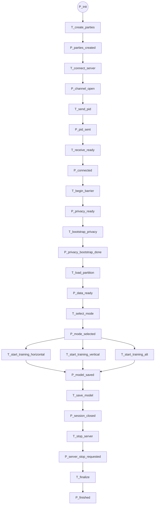

<details>
<summary>09-cpn-formal-skeleton</summary>

Esqueleto formal inicial para desenhar o FedTree no CPN Tools. Este arquivo converte a leitura de fluxo e tipos em uma estrutura de partida: lugares, transições, color sets e inscrições de arcos. A intenção aqui nao e fechar todo o modelo, mas deixar a base pronta para ser desenhada sem retrabalho conceitual.

## Objetivo

Definir uma espinha dorsal suficiente para o CPN Tools, cobrindo:

- interface de paginas substitutas;
- tipos de tokens;
- lugares globais;
- transicoes macro;
- ramos horizontal e vertical;
- ponto de encerramento.

## Premissas

- `IN` e `OUT` sao port places de interface.
- Cada pagina substituta recebe um token tipado em `IN` e devolve um token tipado em `OUT`.
- O modelo privilegia fluxo de controle e troca de estados, nao detalhes numericos do treino.
- O ramo vertical pode ser detalhado mais do que o horizontal para manter o texto e o desenho controlados.

## Color Sets Iniciais

```sml
colset SYSTEMSTATE = record phase: string * mode: string * pid: int;
colset PARTYSTATE = record pid: int * dataset: string * mode: string;
colset SERVERSTATE = record ready: bool * round: int;
colset MODE = with horizontal | vertical | ensemble | solo;
colset PRIVACYTECH = with HE | SA | DP | NONE;
colset BARRIER = unit;
colset CONTROLMSG = string;
colset DATASETBUNDLE = string;
colset PARTITIONSPEC = with partitioned | unpartitioned;
colset PARTITIONEDDATA = string;
colset FEATUREBATCH = string;
colset GHPAIR = string;
colset GHBATCH = string;
colset GHENCBATCH = string;
colset HISTOGRAMMSG = string;
colset FIDBATCH = string;
colset SPLITPOINT = string;
colset NODEMSG = string;
colset SCOREMSG = real;
colset HOMOKEY = string;
colset DHPUBLICKEY = string;
colset SANOISE = string;
colset DPNOISE = string;
colset MODELSTATE = string;
colset STOPMSG = string;
```

## Observacao Sobre Tipos

Os tipos acima sao propositalmente simples. Eles servem para:

- documentar a semantica dos tokens;
- permitir a montagem rapida do modelo;
- separar o que e controle do que e dado de treino;
- deixar claro onde o modo vertical precisa de mais informacao.

Se o desenho exigir mais fidelidade, os `string` podem ser refinados depois em registros mais ricos.

## Lugares Globais

```text
P_init: SYSTEMSTATE
P_parties_created: PARTYSTATE
P_channel_open: CONTROLMSG
P_pid_sent: CONTROLMSG
P_connected: SERVERSTATE
P_privacy_ready: CONTROLMSG
P_privacy_bootstrap_done: CONTROLMSG
P_data_loaded: DATASETBUNDLE
P_data_partitioned: PARTITIONEDDATA
P_data_ready: PARTITIONEDDATA
P_mode_selected: MODE
P_model_saved: MODELSTATE
P_session_closed: STOPMSG
P_server_stop_requested: STOPMSG
P_finished: SYSTEMSTATE
```

## Transicoes Macro

```text
T_create_parties
T_connect_server
T_send_pid
T_receive_ready
T_begin_barrier
T_bootstrap_privacy
T_load_partition
T_select_mode
T_start_training_horizontal
T_start_training_vertical
T_start_training_alt
T_save_model
T_stop_server
T_finalize
```

## Interface Das Paginas

### P0 - Fluxo Geral

- `IN: P_init`
- `OUT: P_finished`
- Função: ligar todas as fases macros do protocolo.

### P1 - Criacao das Parties

- `IN: P_init`
- `OUT: P_parties_created`
- Função: criar party local, carregar dados e inicializar o estado.

### P2 - Comunicacao Cliente-Servidor

- `IN: P_parties_created`
- `OUT: P_connected`
- Função: abrir canal, identificar party, concluir handshake e sair da fase de comunicacao inicial.

### P3 - Barreiras e Prontidao

- `IN: P_connected`
- `OUT: P_privacy_ready`
- Função: manter a sincronizacao ate que todas as parties estejam prontas.

### P4 - Bootstrap de Privacidade

- `IN: P_privacy_ready`
- `OUT: P_privacy_bootstrap_done`
- Função: aplicar `HE`, `SA`, `DP` ou nada.

### P5 - Particao e Carregamento

- `IN: P_privacy_bootstrap_done`
- `OUT: P_data_ready`
- Função: organizar o dataset para o modo escolhido.

### P6 - Treino Horizontal

- `IN: P_data_ready`
- `OUT: P_model_saved`
- Função: detalhar o ciclo horizontal com grades, histogramas, split e prune.

### P7 - Treino Vertical

- `IN: P_data_ready`
- `OUT: P_model_saved`
- Função: detalhar o ciclo vertical com gradients, batches, FID e sincronizacao de nós.

### P8 - Modo Ensemble ou Solo

- `IN: P_data_ready`
- `OUT: P_model_saved`
- Função: manter os ramos alternativos do executavel.

### P9 - Encerramento

- `IN: P_model_saved`
- `OUT: P_finished`
- Função: salvar modelo, solicitar stop e finalizar.

## Esqueleto Do Fluxo Macro



## Skeleton Horizontal

O horizontal e mantido como um ciclo curto e agressivo em termos de dados:

```text
P_data_ready
  -> T_update_gradients
  -> GHPair
  -> T_reduce_ghpair
  -> T_build_tree_round
  -> T_compute_histograms
  -> HistogramMsg
  -> T_get_split_point
  -> SplitPoint
  -> T_update_tree_nodes
  -> NodeMsg
  -> T_prune_and_score
  -> ScoreMsg
  -> P_model_saved
```

### Lugares horizontais sugeridos

- `P_h_gradients`: gradientes locais prontos.
- `P_h_ghpair`: resumo `GHPair`.
- `P_h_histograms`: histogramas produzidos.
- `P_h_splitpoint`: corte escolhido.
- `P_h_nodes`: nós atualizados.
- `P_h_score`: score local ou medio.

## Skeleton Vertical

O vertical merece mais detalhe porque ele mostra melhor a cooperacao real entre parties:

```text
P_data_ready
  -> T_update_gradients
  -> GHPair / GHBatch / GHEncBatch
  -> T_build_tree_round
  -> T_compute_histograms
  -> HistogramMsg + FIDBatch
  -> T_send_GHPair_FIDBatch
  -> T_aggregate_and_choose_best
  -> SplitPoint
  -> T_update_tree_nodes
  -> NodeMsg
  -> T_prune_and_score
  -> ScoreMsg
  -> P_model_saved
```

### Lugares verticais sugeridos

- `P_v_gradients`: gradients correntes.
- `P_v_batches`: batches de gradients ou encodings.
- `P_v_histograms`: histogramas locais.
- `P_v_fidbatch`: identificadores de features.
- `P_v_bestinfo`: informacao do melhor split.
- `P_v_nodesync`: nos sincronizados.
- `P_v_score`: score agregado.

## Guardas Minimas

Algumas decisoes podem virar guards simples:

- `mode = horizontal`
- `mode = vertical`
- `mode = ensemble`
- `mode = solo`
- `privacy = HE`
- `privacy = SA`
- `privacy = DP`
- `privacy = NONE`
- `partition = true`
- `partition = false`

## Inscricoes De Arco Sugeridas

As inscricoes devem refletir o tipo da interface:

- `P_init -> T_create_parties` leva `SYSTEMSTATE`
- `T_create_parties -> P_parties_created` produz `PARTYSTATE`
- `P_parties_created -> T_connect_server` leva `PARTYSTATE`
- `T_connect_server -> P_channel_open` produz `CONTROLMSG`
- `P_channel_open -> T_send_pid` leva `CONTROLMSG`
- `T_send_pid -> P_pid_sent` produz `CONTROLMSG`
- `P_pid_sent -> T_receive_ready` leva `CONTROLMSG`
- `T_receive_ready -> P_connected` produz `SERVERSTATE`
- `P_connected -> T_begin_barrier` leva `SERVERSTATE`
- `T_begin_barrier -> P_privacy_ready` produz `CONTROLMSG`
- `P_privacy_ready -> T_bootstrap_privacy` leva `CONTROLMSG`
- `T_bootstrap_privacy -> P_privacy_bootstrap_done` produz `CONTROLMSG`
- `P_privacy_bootstrap_done -> T_load_partition` leva `CONTROLMSG`
- `T_load_partition -> P_data_ready` produz `PARTITIONEDDATA`
- `P_data_ready -> T_start_training_horizontal` leva `PARTITIONEDDATA`
- `P_data_ready -> T_start_training_vertical` leva `PARTITIONEDDATA`
- `P_data_ready -> T_start_training_alt` leva `PARTITIONEDDATA`
- `T_start_training_horizontal -> P_model_saved` produz `MODELSTATE`
- `T_start_training_vertical -> P_model_saved` produz `MODELSTATE`
- `T_start_training_alt -> P_model_saved` produz `MODELSTATE`
- `P_model_saved -> T_stop_server` leva `MODELSTATE`
- `T_stop_server -> P_session_closed` produz `STOPMSG`
- `P_session_closed -> T_finalize` leva `STOPMSG`
- `T_finalize -> P_finished` produz `SYSTEMSTATE`

## O Que Ja Esta Suficiente Para Desenhar

Com este esqueleto, ja e possivel montar no CPN Tools:

- a pagina raiz;
- as paginas P1 a P9;
- as interfaces IN/OUT;
- os lugares globais principais;
- a separacao minima entre controle, privacidade e dados;
- o split entre horizontal e vertical;
- a ideia de encerramento em duas etapas, `P_model_saved` e `P_finished`.

## O Que Ainda Pode Ser Refinado Depois

- detalhar as subpaginas de `P1` e `P2`;
- abrir os loops internos de `P6` e `P7`;
- separar melhor `P_privacy_ready` e `P_privacy_bootstrap_done`;
- definir tipos mais ricos para `GHPair`, `NodeMsg` e `SplitPoint`;
- representar `StopServer` com mensagens e tempos reais, se isso for necessario para a analise.

</details>
