11-p0-flow

Fluxograma dedicado da pagina `P0 - Fluxo Geral`. Esta pagina e a espinha dorsal da modelagem CPN: ela so mostra o encadeamento macro do protocolo, deixando o detalhe para `P1` a `P9`.

## Leitura

- `Lugar` representa estado.
- `Transicao` representa acao ou passo do protocolo.
- Em CPN Tools, as transicoes aqui devem ser tratadas como transicoes macro ou substitution transitions conforme a pagina filha correspondente.

## Fluxograma

```mermaid
flowchart LR
    P_init((P_init))
    T_create_parties[T_create_parties]
    P_parties_created((P_parties_created))
    T_connect_server[T_connect_server]
    P_connected((P_connected))
    T_begin_barrier[T_begin_barrier]
    T_bootstrap_privacy[T_bootstrap_privacy]
    P_privacy_ready((P_privacy_ready))
    P_privacy_bootstrap_done((P_privacy_bootstrap_done))
    T_load_partition[T_load_partition]
    P_data_ready((P_data_ready))
    T_select_mode[T_select_mode]
    P_mode_selected((P_mode_selected))
    T_start_training_horizontal[T_start_training_horizontal]
    T_start_training_vertical[T_start_training_vertical]
    T_start_training_alt[T_start_training_alt]
    P_model_saved((P_model_saved))
    T_stop_server[T_stop_server]
    P_server_stop_requested((P_server_stop_requested))
    T_finalize[T_finalize]
    P_finished((P_finished))

    P_init --> T_create_parties --> P_parties_created
    P_parties_created --> T_connect_server --> P_connected
    P_connected --> T_begin_barrier --> P_privacy_ready
    P_privacy_ready --> T_bootstrap_privacy --> P_privacy_bootstrap_done
    P_privacy_bootstrap_done --> T_load_partition --> P_data_ready
    P_data_ready --> T_select_mode --> P_mode_selected
    P_mode_selected --> T_start_training_horizontal --> P_model_saved
    P_mode_selected --> T_start_training_vertical --> P_model_saved
    P_mode_selected --> T_start_training_alt --> P_model_saved
    P_model_saved --> T_stop_server --> P_server_stop_requested
    P_server_stop_requested --> T_finalize --> P_finished
```

## Mapeamento Para CPN Tools

- `P_init`: lugar de entrada da pagina raiz.
- `T_create_parties`: substitui `P1 - Criação das Parties`.
- `P_parties_created`: estado apos a criacao das parties.
- `T_connect_server`: transicao substituta expandida por `P2 - Comunicação Cliente-Servidor`.
- `P_connected`: conexao e handshake inicial concluidos.
- `T_begin_barrier`: transicao substituta expandida por `P3 - Barreiras e Prontidão`.
- `T_bootstrap_privacy`: substitui `P4 - Bootstrap de Privacidade`.
- `P_privacy_ready`: prontidao apos o bootstrap.
- `P_privacy_bootstrap_done`: bootstrap de privacidade concluido.
- `T_load_partition`: substitui `P5 - Partição e Carregamento`.
- `P_data_ready`: dados prontos para treino.
- `T_select_mode`: escolhe o ramo operacional.
- `P_mode_selected`: modo definido.
- `T_start_training_horizontal`: abre `P6 - Treino Horizontal`.
- `T_start_training_vertical`: abre `P7 - Treino Vertical`.
- `T_start_training_alt`: abre `P8 - Modo Ensemble ou Solo`.
- `P_model_saved`: modelo salvo.
- `T_stop_server`: solicita encerramento da sessao.
- `P_server_stop_requested`: parada do servidor solicitada.
- `T_finalize`: substitui `P9 - Encerramento`.
- `P_finished`: fim do protocolo.

