12-p1-flow

Fluxograma dedicado da pagina `P1 - Criação das Parties`. Esta pagina e a primeira subpagina concreta do fluxo CPN e deve ser chamada a partir de `T_create_parties` em `P0`.

## Relacao Hierarquica

- Pagina pai: `P0 - Fluxo Geral`
- Transicao substituta na pagina pai: `T_create_parties`
- Funcao da subpagina: criar a party local, carregar dados e preparar o estado inicial antes da comunicacao com o servidor

## Interface

- `IN: P_init`
- `OUT: P_parties_created`

## Fluxograma

```mermaid
flowchart LR
    P_init((P_init))
    T_create_parties[T_create_parties]
    P_context_ready((P_context_ready))
    T_setup_logs[T_setup_logs]
    P_logs_ready((P_logs_ready))
    T_read_params[T_read_params]
    P_params_ready((P_params_ready))
    T_define_num_parties[T_define_num_parties]
    P_count_ready((P_count_ready))
    T_load_dataset[T_load_dataset]
    P_data_loaded((P_data_loaded))
    T_adjust_classes[T_adjust_classes]
    P_classes_ready((P_classes_ready))
    T_partition_local[T_partition_local]
    P_data_partitioned((P_data_partitioned))
    T_init_party[T_init_party]
    P_parties_created((P_parties_created))

    P_init --> T_create_parties --> P_context_ready
    P_context_ready --> T_setup_logs --> P_logs_ready
    P_logs_ready --> T_read_params --> P_params_ready
    P_params_ready --> T_define_num_parties --> P_count_ready
    P_count_ready --> T_load_dataset --> P_data_loaded
    P_data_loaded --> T_adjust_classes --> P_classes_ready
    P_classes_ready --> T_partition_local --> P_data_partitioned
    P_data_partitioned --> T_init_party
    T_init_party --> P_parties_created
```

## Mapeamento Para CPN Tools

- `P_init`: estado de entrada da pagina.
- `T_create_parties`: transicao macro que representa a criacao da party local.
- `P_context_ready`: contexto inicial da party recebido.
- `T_setup_logs`: configuracao de logs.
- `P_logs_ready`: ambiente de execucao preparado.
- `T_read_params`: leitura de parametros e pid.
- `P_params_ready`: parametros prontos para uso.
- `T_define_num_parties`: definicao do numero de parties.
- `P_count_ready`: contagem e topologia local definidas.
- `T_load_dataset`: carregamento do dataset.
- `P_data_loaded`: dados locais carregados.
- `T_adjust_classes`: ajuste de classes e modo inicial.
- `P_classes_ready`: dados e classes prontos para particionamento.
- `T_partition_local`: particionamento local ou selecao do subconjunto da party.
- `P_data_partitioned`: dados preparados para a inicializacao.
- `T_init_party`: inicializacao do estado interno da party.
- `P_parties_created`: estado de saida da pagina.

## Observacao De Modelagem

Este `P1` nao possui ramificacoes internas.
Ele continua sendo a subpagina de `T_create_parties`, mas passa a encapsular logs, parametros, carga de dados, particionamento local e inicializacao em uma unica trilha linear.

