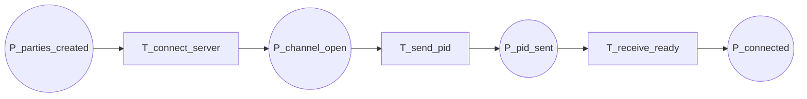

13-p2-flow

Fluxograma dedicado da pagina `P2 - Comunicação Cliente-Servidor`. Esta pagina expande a transicao `T_connect_server` de `P0`.

## Relacao Hierarquica

- Pagina pai: `P0 - Fluxo Geral`
- Transicao substituta na pagina pai: `T_connect_server`
- Funcao da subpagina: abrir a comunicacao com o servidor, enviar o PID e receber `Ready`

## Interface

- `IN: P_parties_created`
- `OUT: P_connected`

## Fluxograma

## Mapeamento Para CPN Tools

- `P_parties_created`: entrada da pagina, herdada de `P1`.
- `T_connect_server`: abertura do canal gRPC e associacao com o servidor.
- `P_channel_open`: canal aberto.
- `T_send_pid`: envio do identificador da party.
- `P_pid_sent`: PID enviado.
- `T_receive_ready`: recepcao do `Ready` do servidor.
- `P_connected`: saida da pagina, pronta para a sincronizacao seguinte.

## Observacao De Modelagem

Este `P2` concentra apenas a comunicacao inicial.
A sincronizacao efetiva com todas as parties fica na proxima pagina, `P3 - Barreiras e Prontidão`.

