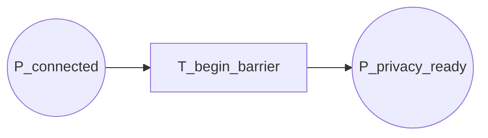

14-p3-flow

Fluxograma dedicado da pagina `P3 - Barreiras e Prontidão`. Esta pagina expande a transicao `T_begin_barrier` de `P0`.

## Relacao Hierarquica

- Pagina pai: `P0 - Fluxo Geral`
- Transicao substituta na pagina pai: `T_begin_barrier`
- Funcao da subpagina: aguardar a liberacao da barreira inicial e entregar a prontidao para o bootstrap seguinte

## Interface

- `IN: P_connected`
- `OUT: P_privacy_ready`

## Fluxograma

## Mapeamento Para CPN Tools

- `P_connected`: entrada da pagina, herdada de `P2`.
- `T_begin_barrier`: barreira inicial e sincronizacao das parties.
- `P_privacy_ready`: saida da pagina, pronta para o bootstrap de privacidade.

## Observacao De Modelagem

Este `P3` representa a sincronizacao antes da fase de privacidade.
A pagina nao precisa expor detalhes internos de espera se o objetivo for manter a leitura macro limpa.

