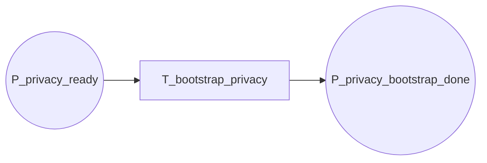

15-p4-flow

Fluxograma dedicado da pagina `P4 - Bootstrap de Privacidade`. Esta pagina expande a transicao `T_bootstrap_privacy` de `P0`.

## Relacao Hierarquica

- Pagina pai: `P0 - Fluxo Geral`
- Transicao substituta na pagina pai: `T_bootstrap_privacy`
- Funcao da subpagina: executar o bootstrap de privacidade antes do carregamento e do treino

## Interface

- `IN: P_privacy_ready`
- `OUT: P_privacy_bootstrap_done`

## Fluxograma

## Mapeamento Para CPN Tools

- `P_privacy_ready`: entrada da pagina, herdada de `P3`.
- `T_bootstrap_privacy`: bootstrap macro que cobre `HE`, `SA`, `DP` ou nenhum mecanismo conforme o contexto do protocolo.
- `P_privacy_bootstrap_done`: saida da pagina, pronta para a particao e o carregamento.

## Observacao De Modelagem

Este `P4` deve permanecer linear como pagina macro.
Os detalhes especificos de cada tecnica de privacidade ficam absorvidos pela propria transicao de bootstrap.

