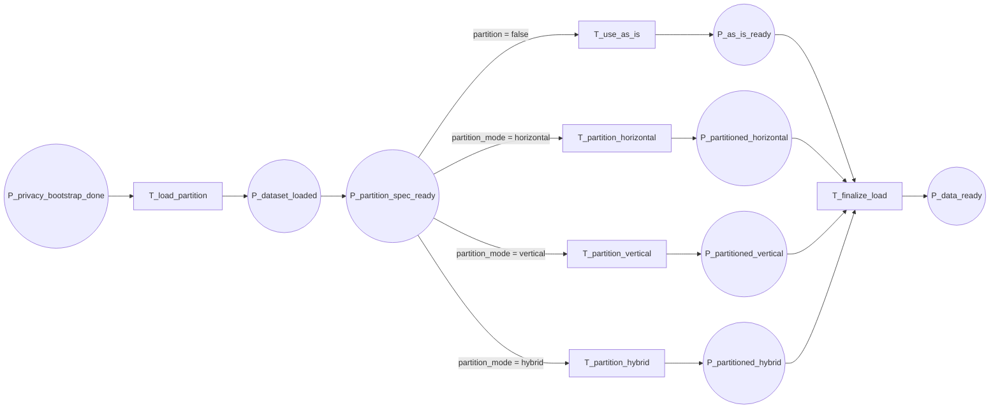

16-p5-flow

Fluxograma dedicado da pagina `P5 - Partição e Carregamento`. Esta pagina expande a transicao `T_load_partition` de `P0` e detalha o carregamento dos dados junto com a decisao de particionamento.

## Relacao Hierarquica

- Pagina pai: `P0 - Fluxo Geral`
- Transicao substituta na pagina pai: `T_load_partition`
- Funcao da subpagina: carregar os dados e organizar a particao antes da entrada no treino

## Interface

- `IN: P_privacy_bootstrap_done`
- `OUT: P_data_ready`

## Fluxograma

## Mapeamento Para CPN Tools

- `P_privacy_bootstrap_done`: entrada da pagina, herdada de `P4`.
- `T_load_partition`: carrega o conjunto de dados para a fase de particionamento.
- `P_dataset_loaded`: dados carregados e prontos para a organizacao local.
- `P_partition_spec_ready`: ponto de decisao da particao, sem losango no desenho.
- `T_use_as_is`: caminho sem particionamento, quando os dados ja estao prontos.
- `T_partition_horizontal`: separa amostras entre as parties.
- `T_partition_vertical`: separa features entre as parties.
- `T_partition_hybrid`: executa particionamento misto.
- `P_as_is_ready`: dados prontos sem recorte adicional.
- `P_partitioned_horizontal`: dados particionados horizontalmente.
- `P_partitioned_vertical`: dados particionados verticalmente.
- `P_partitioned_hybrid`: dados particionados em modo híbrido.
- `T_finalize_load`: unifica os ramos e libera o treino.
- `P_data_ready`: saida da pagina, pronta para `P6`, `P7` ou `P8`.

## Observacao De Modelagem

Este `P5` e o melhor candidato para mais detalhe porque ele encapsula o comportamento de particionamento do protocolo.
Se for necessario refinar depois, os ramos horizontais e verticais podem ganhar subpáginas sem alterar a interface externa.

