17-p6-flow

Fluxograma dedicado da pagina `P6 - Treino Horizontal`. Esta pagina expande a transicao `T_start_training_horizontal` de `P0` no ramo horizontal.

## Relacao Hierarquica

- Pagina pai: `P0 - Fluxo Geral`
- Transicao substituta na pagina pai: `T_start_training_horizontal`
- Funcao da subpagina: executar a rodada horizontal de treino, sincronizar cortes, histogramas, splits e parada da arvore

## Interface

- `IN: P_data_ready`
- `OUT: P_model_saved`

## Fluxograma

```mermaid
flowchart LR
    P_data_ready((P_data_ready))
    T_update_gradients[T_update_gradients]
    P_gradients_ready((P_gradients_ready))
    T_reduce_ghpair[T_reduce_ghpair]
    P_ghpair_ready((P_ghpair_ready))
    T_build_tree_round[T_build_tree_round]
    P_round_ready((P_round_ready))
    T_collect_ranges[T_collect_ranges]
    T_collect_party_cuts[T_collect_party_cuts]
    P_cutpoints_ready((P_cutpoints_ready))
    T_compute_histograms[T_compute_histograms]
    P_histograms_ready((P_histograms_ready))
    T_encrypt_histograms[T_encrypt_histograms]
    T_add_noise[T_add_noise]
    T_send_clear_histograms[T_send_clear_histograms]
    P_histograms_sent((P_histograms_sent))
    T_get_split_point[T_get_split_point]
    P_split_received((P_split_received))
    T_prune_and_score[T_prune_and_score]
    P_model_saved((P_model_saved))

    P_data_ready --> T_update_gradients --> P_gradients_ready
    P_gradients_ready --> T_reduce_ghpair --> P_ghpair_ready
    P_ghpair_ready --> T_build_tree_round --> P_round_ready

    P_round_ready -->|server| T_collect_ranges --> P_cutpoints_ready
    P_round_ready -->|party| T_collect_party_cuts --> P_cutpoints_ready

    P_cutpoints_ready --> T_compute_histograms --> P_histograms_ready
    P_histograms_ready -->|privacy_tech = HE| T_encrypt_histograms --> P_histograms_sent
    P_histograms_ready -->|privacy_tech = SA| T_add_noise --> P_histograms_sent
    P_histograms_ready -->|privacy_tech = none or dp| T_send_clear_histograms --> P_histograms_sent

    P_histograms_sent --> T_get_split_point --> P_split_received
    P_split_received --> T_prune_and_score --> P_model_saved
```

## Mapeamento Para CPN Tools

- `P_data_ready`: entrada da pagina, herdada de `P5`.
- `T_update_gradients`: atualiza os gradients locais do treino horizontal.
- `P_gradients_ready`: gradients prontos para agregacao.
- `T_reduce_ghpair`: reduz os gradients e hessians em um resumo `GHPair`.
- `P_ghpair_ready`: resumo pronto para a rodada.
- `T_build_tree_round`: inicia a construcao da arvore da rodada.
- `P_round_ready`: rodada preparada para escolha de cut points.
- `T_collect_ranges`: ramo em que o servidor coleta ranges das features.
- `T_collect_party_cuts`: ramo em que as parties enviam cut points locais.
- `P_cutpoints_ready`: base de discretizacao consolidada.
- `T_compute_histograms`: computa histogramas por nivel.
- `P_histograms_ready`: histogramas locais prontos.
- `T_encrypt_histograms`: aplica cifragem quando o modo usa `HE`.
- `T_add_noise`: aplica ruido quando o modo usa `SA`.
- `T_send_clear_histograms`: envia histogramas em claro quando nao ha camada extra.
- `P_histograms_sent`: histogramas enviados ao servidor.
- `T_get_split_point`: recebe o `SplitPoint` escolhido.
- `P_split_received`: ponto de divisao recebido.
- `T_prune_and_score`: poda local, atualiza predição e finaliza a rodada.
- `P_model_saved`: saida da pagina, com o modelo pronto para o encerramento.

## Observacao De Modelagem

Este `P6` e propositalmente mais detalhado porque o treino horizontal tem mais comunicacao com o servidor do que a pagina raiz deve expor.
Se for necessario refinar depois, o ramo de `privacy_tech` pode ganhar subpáginas sem alterar a interface externa.

