17-p6-flow

Fluxograma dedicado da pagina `P6 - Treino Horizontal`. Esta pagina expande a transicao `T_start_training_horizontal` de `P0` no ramo horizontal.

## Relacao Hierarquica

- Pagina pai: `P0 - Fluxo Geral`
- Transicao substituta na pagina pai: `T_start_training_horizontal`
- Funcao da subpagina: executar a rodada horizontal de treino, sincronizar cortes, histogramas, splits e parada da arvore

## Interface

- `IN: P_mode_selected`
- `OUT: P_training_active`

## Fluxograma

```mermaid
flowchart LR
    P_mode_selected((P_mode_selected))
    T_start_training_horizontal[T_start_training_horizontal]
    P_training_active((P_training_active))
    T_prepare_cut_points[T_prepare_cut_points]
    P_cutpoints_ready((P_cutpoints_ready))
    T_update_gradients[T_update_gradients]
    P_gradients_ready((P_gradients_ready))
    T_reduce_ghpair[T_reduce_ghpair]
    P_ghpair_ready((P_ghpair_ready))
    T_build_tree_round[T_build_tree_round]
    P_round_ready((P_round_ready))
    T_compute_histograms[T_compute_histograms]
    P_histograms_ready((P_histograms_ready))
    T_encrypt_histograms[T_encrypt_histograms]
    T_add_noise[T_add_noise]
    T_send_clear_histograms[T_send_clear_histograms]
    P_histograms_sent((P_histograms_sent))
    T_merge_histograms[T_merge_histograms]
    P_histograms_merged((P_histograms_merged))
    T_compute_gain[T_compute_gain]
    P_gain_ready((P_gain_ready))
    T_select_best_split[T_select_best_split]
    P_split_received((P_split_received))
    T_update_tree[T_update_tree]
    P_tree_updated((P_tree_updated))
    T_prune_and_score[T_prune_and_score]
    P_training_active((P_training_active))

    P_mode_selected --> T_start_training_horizontal --> P_training_active
    P_training_active --> T_prepare_cut_points --> P_cutpoints_ready
    P_cutpoints_ready --> T_update_gradients --> P_gradients_ready
    P_gradients_ready --> T_reduce_ghpair --> P_ghpair_ready
    P_ghpair_ready --> T_build_tree_round --> P_round_ready

    P_round_ready --> T_compute_histograms --> P_histograms_ready
    P_histograms_ready -->|privacy_tech = HE| T_encrypt_histograms --> P_histograms_sent
    P_histograms_ready -->|privacy_tech = SA| T_add_noise --> P_histograms_sent
    P_histograms_ready -->|privacy_tech = none or dp| T_send_clear_histograms --> P_histograms_sent

    P_histograms_sent --> T_merge_histograms --> P_histograms_merged
    P_histograms_merged --> T_compute_gain --> P_gain_ready
    P_gain_ready --> T_select_best_split --> P_split_received
    P_split_received --> T_update_tree --> P_tree_updated
    P_tree_updated --> T_prune_and_score --> P_training_active
```

## Mapeamento Para CPN Tools

- `P_mode_selected`: entrada da pagina, herdada de `P0`.
- `T_start_training_horizontal`: abre o ramo horizontal depois da selecao de modo.
- `P_training_active`: estado intermediario que marca o treinamento horizontal em execucao.
- `T_prepare_cut_points`: prepara os cut points iniciais conforme `propose_split` e o mecanismo de particionamento.
- `P_cutpoints_ready`: cut points preparados para a rodada.
- `T_update_gradients`: atualiza os gradients locais do treino horizontal.
- `P_gradients_ready`: gradients prontos para agregacao.
- `T_reduce_ghpair`: reduz os gradients e hessians em um resumo `GHPair`.
- `P_ghpair_ready`: resumo pronto para a rodada.
- `T_build_tree_round`: inicia a construcao da arvore da rodada.
- `P_round_ready`: rodada preparada para escolha de cut points.
- `T_compute_histograms`: computa histogramas por nivel.
- `P_histograms_ready`: histogramas locais prontos.
- `T_encrypt_histograms`: aplica cifragem quando o modo usa `HE`.
- `T_add_noise`: aplica ruido quando o modo usa `SA`.
- `T_send_clear_histograms`: envia histogramas em claro quando nao ha camada extra.
- `P_histograms_sent`: histogramas enviados ao servidor.
- `T_merge_histograms`: consolida os histogramas no agregador.
- `P_histograms_merged`: histogramas consolidados.
- `T_compute_gain`: calcula ganho por nivel a partir dos histogramas.
- `P_gain_ready`: ganhos calculados e prontos para selecao.
- `T_select_best_split`: escolhe o melhor split para o nivel atual.
- `P_split_received`: ponto de divisao recebido.
- `T_update_tree`: aplica o split e sincroniza a arvore entre parties.
- `P_tree_updated`: arvore atualizada para decidir continuidade.
- `T_prune_and_score`: poda local, atualiza predição e finaliza a rodada.
- `P_training_active`: saida da pagina, com o treino horizontal ativo para continuidade do fluxo.

## Observacao De Modelagem

Este `P6` ainda e uma simplificacao do codigo real, mas agora esta mais proximo da sequencia efetiva da implementacao horizontal:
primeiro seleciona o ramo de treino, depois prepara os cortes, calcula gradients, monta histogramas, agrega, escolhe o split e atualiza a arvore.
O estado final da pagina e `P_training_active`, que representa o treino horizontal em andamento para continuidade do protocolo.
Se for necessario refinar depois, o ramo de `propose_split` pode ganhar subpáginas sem alterar a interface externa.

