18-p7-flow

Fluxograma dedicado da pagina `P7 - Treino Vertical`. Esta pagina expande a transicao `T_start_training_vertical` de `P0` no ramo vertical.

## Relacao Hierarquica

- Pagina pai: `P0 - Fluxo Geral`
- Transicao substituta na pagina pai: `T_start_training_vertical`
- Funcao da subpagina: executar o ciclo vertical completo, escolhendo entre label local, batches de gradientes, cifragem opcional, agregacao, atualizacao da arvore e poda final

## Interface

- `IN: P_data_ready`
- `OUT: P_model_saved`

## Fluxograma

```mermaid
flowchart LR
    P_data_ready((P_data_ready))
    T_update_gradients[T_update_gradients]
    P_gradients_ready((P_gradients_ready))
    T_set_local_gradients[T_set_local_gradients]
    T_get_gradient_batches[T_get_gradient_batches]
    P_batches_ready((P_batches_ready))
    T_get_encrypted_gradients[T_get_encrypted_gradients]
    T_get_plain_gradients[T_get_plain_gradients]
    P_vertical_ready((P_vertical_ready))
    T_build_tree_round[T_build_tree_round]
    P_round_ready((P_round_ready))
    T_compute_histograms[T_compute_histograms]
    P_histograms_ready((P_histograms_ready))
    T_send_GHPair_FIDBatch[T_send_GHPair_FIDBatch]
    P_sync_ready((P_sync_ready))
    T_aggregate_and_choose_best[T_aggregate_and_choose_best]
    T_wait_bestinfo[T_wait_bestinfo]
    P_tree_updated((P_tree_updated))
    T_prune_and_score[T_prune_and_score]
    P_model_saved((P_model_saved))

    P_data_ready --> T_update_gradients --> P_gradients_ready
    P_gradients_ready -->|has_label = true| T_set_local_gradients --> P_vertical_ready
    P_gradients_ready -->|has_label = false| T_get_gradient_batches --> P_batches_ready
    P_batches_ready -->|privacy_tech = HE| T_get_encrypted_gradients --> P_vertical_ready
    P_batches_ready -->|privacy_tech = none| T_get_plain_gradients --> P_vertical_ready

    P_vertical_ready --> T_build_tree_round --> P_round_ready
    P_round_ready --> T_compute_histograms --> P_histograms_ready
    P_histograms_ready --> T_send_GHPair_FIDBatch --> P_sync_ready
    P_sync_ready -->|PID = 0| T_aggregate_and_choose_best --> P_tree_updated
    P_sync_ready -->|PID != 0| T_wait_bestinfo --> P_tree_updated
    P_tree_updated -->|continuar dividindo = sim| T_compute_histograms
    P_tree_updated -->|continuar dividindo = não| T_prune_and_score --> P_model_saved
```

## Mapeamento Para CPN Tools

- `P_data_ready`: entrada da pagina, herdada de `P5`.
- `T_update_gradients`: atualiza os gradients locais do treino vertical.
- `P_gradients_ready`: gradients preparados para definir o próximo ramo.
- `T_set_local_gradients`: usa label local quando a party possui supervisao.
- `T_get_gradient_batches`: solicita batches de gradients quando nao ha label.
- `P_batches_ready`: batches recebidos e prontos para processar.
- `T_get_encrypted_gradients`: recebe gradientes cifrados quando `HE` esta ativo.
- `T_get_plain_gradients`: recebe gradientes em claro quando nao ha cifragem.
- `P_vertical_ready`: estado consolidado para entrar na rodada da arvore.
- `T_build_tree_round`: inicia a construcao da rodada vertical.
- `P_round_ready`: rodada preparada para computo de histogramas.
- `T_compute_histograms`: computa histogramas da rodada atual.
- `P_histograms_ready`: histogramas locais prontos.
- `T_send_GHPair_FIDBatch`: envia `GHPair` e `FIDBatch` para sincronizacao.
- `P_sync_ready`: estado sincronizado entre parties.
- `T_aggregate_and_choose_best`: ramo do PID 0 que agrega e escolhe o melhor corte.
- `T_wait_bestinfo`: ramo das demais parties que aguardam o corte escolhido.
- `P_tree_updated`: arvore atualizada com o melhor split conhecido.
- `T_prune_and_score`: poda a arvore e finaliza o ciclo.
- `P_model_saved`: saida da pagina, com o modelo pronto para o encerramento.

## Observacao De Modelagem

Esta pagina detalha o ramo vertical porque ele concentra a maior variacao de comportamento entre parties.
Se o desenho precisar ser refinado depois, o bloco de agregacao pode ganhar uma subpagina sem alterar a interface externa.

