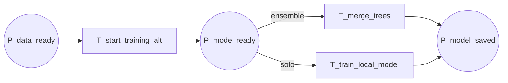

19-p8-flow

Fluxograma dedicado da pagina `P8 - Modo Ensemble ou Solo`. Esta pagina expande a transicao `T_start_training_alt` de `P0` no ramo alternativo.

## Relacao Hierarquica

- Pagina pai: `P0 - Fluxo Geral`
- Transicao substituta na pagina pai: `T_start_training_alt`
- Funcao da subpagina: escolher entre treino em ensemble ou treino local isolado, mantendo a saida unica em `P_model_saved`

## Interface

- `IN: P_data_ready`
- `OUT: P_model_saved`

## Fluxograma

## Mapeamento Para CPN Tools

- `P_data_ready`: entrada da pagina, herdada de `P5`.
- `T_start_training_alt`: inicia o ramo alternativo do treinamento.
- `P_mode_ready`: estado em que a pagina escolhe entre ensemble e solo.
- `T_merge_trees`: combina arvores quando o modo eh ensemble.
- `T_train_local_model`: executa o treino local quando o modo eh solo.
- `P_model_saved`: saida da pagina, com o modelo pronto para o encerramento.

## Observacao De Modelagem

Esta pagina existe para manter o ramo alternativo separado dos treinos horizontal e vertical.
Se o fluxo alternativo ganhar mais detalhes depois, a bifurcacao pode ser expandida sem mudar a interface com `P0`.

