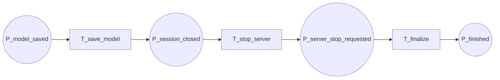

20-p9-flow

Fluxograma dedicado da pagina `P9 - Encerramento`. Esta pagina recebe o modelo salvo, persiste o resultado final, encerra a sessao com o servidor e conclui o protocolo.

## Relacao Hierarquica

- Pagina pai: `P0 - Fluxo Geral`
- Transicao substituta na pagina pai: `T_finalize`
- Funcao da subpagina: consolidar o modelo salvo, requisitar a parada do servidor e entregar o estado final do sistema

## Interface

- `IN: P_model_saved`
- `OUT: P_finished`

## Fluxograma

## Mapeamento Para CPN Tools

- `P_model_saved`: entrada da pagina, herdada de `P6`, `P7` ou `P8`.
- `T_save_model`: persiste o modelo treinado ou consolida o estado final.
- `P_session_closed`: estado intermediario apos o salvamento.
- `T_stop_server`: solicita o encerramento da sessao ao servidor.
- `P_server_stop_requested`: confirma que a parada foi solicitada.
- `T_finalize`: conclui a execucao do sistema.
- `P_finished`: saida final do protocolo.

## Observacao De Modelagem

Esta pagina fecha a cadeia de paginas substitutas do FedTree.
Se o encerramento ganhar mais passos de rede depois, eles devem aparecer aqui sem voltar para o `P0`.

