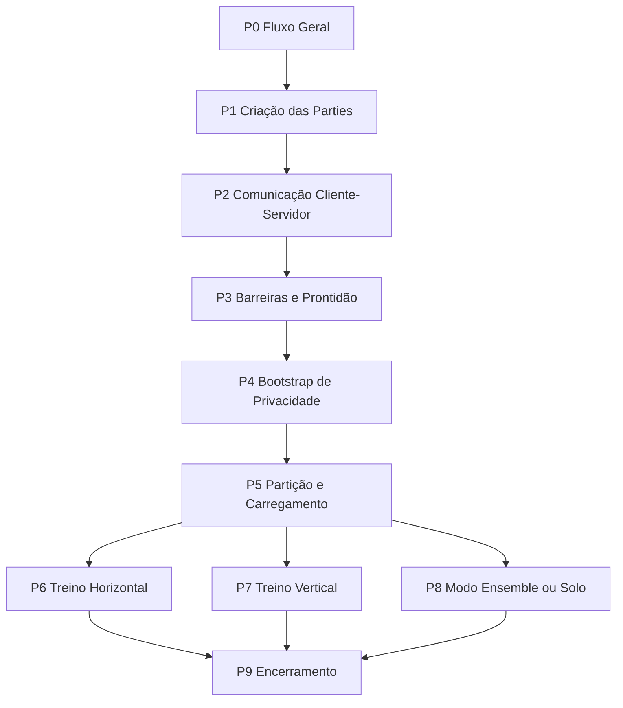

21-visao-completa

# Visão Completa do Funcionamento do FedTree

Este documento consolida a engenharia reversa do projeto FedTree em português e em uma ordem compatível com os fluxogramas desta branch. A ideia é explicar o sistema como ele realmente se organiza no código e como isso aparece na modelagem conceitual `P0 -> P9`.

## 1. O Que é o FedTree

O FedTree é um sistema de aprendizado federado baseado em árvores de decisão, com suporte a:

- treino horizontal;
- treino vertical;
- modo ensemble;
- modo solo;
- treino centralizado;
- mecanismos de privacidade como `HE`, `SA` e `DP`.

No código-fonte, ele é dividido entre:

- entrada principal de treino em [`src/FedTree/fedtree_train.cpp`](../../src/FedTree/fedtree_train.cpp);
- entrada principal de predição em [`src/FedTree/fedtree_predict.cpp`](../../src/FedTree/fedtree_predict.cpp);
- servidor distribuído em [`src/FedTree/distributed_server.cpp`](../../src/FedTree/distributed_server.cpp);
- party distribuída em [`src/FedTree/distributed_party.cpp`](../../src/FedTree/distributed_party.cpp);
- orquestração de treino em [`src/FedTree/FL/FLtrainer.cpp`](../../src/FedTree/FL/FLtrainer.cpp);
- parsing de configuração em [`src/FedTree/parser.cpp`](../../src/FedTree/parser.cpp);
- dados e particionamento em [`src/FedTree/dataset.cpp`](../../src/FedTree/dataset.cpp) e [`src/FedTree/FL/partition.cpp`](../../src/FedTree/FL/partition.cpp).

## 2. Visão Geral da Execução

A execução pode ser entendida em duas camadas:

- **camada de controle**: leitura de parâmetros, criação de parties, handshake, barreira, bootstrap de privacidade e encerramento;
- **camada de treino**: carregamento dos dados, particionamento, construção da árvore, escolha de splits, poda e persistência do modelo.

Os fluxogramas desta branch seguem essa separação. O macrofluxo é:

## 3. Ponto de Entrada do Sistema

### `FedTree-train`

O executável de treino centralizado ou federado é iniciado em [`src/FedTree/fedtree_train.cpp`](../../src/FedTree/fedtree_train.cpp). Ali o fluxo básico é:

1. configurar logging;
2. ler parâmetros com `Parser`;
3. decidir modo de execução;
4. carregar e/ou particionar dados;
5. inicializar parties e servidor quando necessário;
6. chamar o treinador adequado em `FLtrainer`;
7. avaliar o modelo quando houver dataset de teste;
8. encerrar a execução.

### `FedTree-predict`

O executável de inferência está em [`src/FedTree/fedtree_predict.cpp`](../../src/FedTree/fedtree_predict.cpp). Ele carrega o modelo salvo, carrega o dataset de inferência e executa a predição com a estrutura `GBDT`.

### Modo distribuído

O modo distribuído usa:

- [`src/FedTree/distributed_server.cpp`](../../src/FedTree/distributed_server.cpp) como coordenador;
- [`src/FedTree/distributed_party.cpp`](../../src/FedTree/distributed_party.cpp) como cliente/pária participante.

Nesse modo, a comunicação é feita via gRPC e o fluxo deixa de ser apenas local.

## 4. O Papel de Cada Página do Fluxograma

### P0 - Fluxo Geral

`P0` é a espinha dorsal. Ele existe para encadear toda a execução sem entrar em detalhes internos.

No código, esse papel aparece como a sequência geral montada em [`src/FedTree/fedtree_train.cpp`](../../src/FedTree/fedtree_train.cpp):

- parsing de parâmetros;
- preparação de dados;
- inicialização de parties;
- inicialização do servidor;
- escolha do modo de treino;
- encerramento final.

O arquivo `docs/flow/11-p0-flow.md` representa essa visão macro.

### P1 - Criação das Parties

`P1` cobre a fase em que o sistema monta o contexto local de cada party.

Na prática, isso inclui:

- configuração de logs;
- leitura dos parâmetros;
- definição do número de parties;
- carregamento do dataset;
- ajuste de classes;
- particionamento local quando necessário;
- inicialização da party.

Essa lógica é visível em [`src/FedTree/fedtree_train.cpp`](../../src/FedTree/fedtree_train.cpp), com suporte de [`src/FedTree/FL/partition.cpp`](../../src/FedTree/FL/partition.cpp) e das estruturas de party em [`include/FedTree/FL/party.h`](../../include/FedTree/FL/party.h).

### P2 - Comunicação Cliente-Servidor

`P2` cobre a comunicação inicial com o servidor:

- abertura do canal;
- envio do PID;
- recepção de `Ready`.

Esse passo corresponde ao handshake inicial implementado no fluxo distribuído em [`src/FedTree/distributed_party.cpp`](../../src/FedTree/distributed_party.cpp) e atendido em [`src/FedTree/distributed_server.cpp`](../../src/FedTree/distributed_server.cpp).

### P3 - Barreiras e Prontidão

`P3` existe para segurar o início real do treino até que todas as parties estejam sincronizadas.

Essa etapa é importante porque o FedTree não começa a construir árvore imediatamente. Primeiro ele garante que o conjunto de participantes está pronto para a rodada.

### P4 - Bootstrap de Privacidade

`P4` seleciona ou prepara o mecanismo de privacidade do fluxo:

- `HE`;
- `SA`;
- `DP`;
- ou nenhum mecanismo adicional.

O comportamento conceitual está refletido em `docs/flow/15-p4-flow.md` e no tratamento de privacidade presente em [`src/FedTree/distributed_server.cpp`](../../src/FedTree/distributed_server.cpp) e [`src/FedTree/FL/FLtrainer.cpp`](../../src/FedTree/FL/FLtrainer.cpp).

### P5 - Partição e Carregamento

`P5` é o ponto em que os dados deixam de ser apenas arquivos e passam a virar contexto de treino.

Dependendo da configuração, o sistema:

- usa os dados como estão;
- particiona horizontalmente;
- particiona verticalmente;
- ou faz particionamento híbrido.

Essa fase está diretamente ligada a [`src/FedTree/dataset.cpp`](../../src/FedTree/dataset.cpp) e [`src/FedTree/FL/partition.cpp`](../../src/FedTree/FL/partition.cpp).

### O Que É Gradiente

No FedTree, `gradiente` é a medida do erro local da predição em relação ao valor real.

Em termos práticos:

- ele vem da derivada da função de perda em relação à saída do modelo;
- indica a direção e a intensidade da correção necessária;
- é usado junto com o hessiano para calcular bons splits.

O `hessiano` é a segunda derivada da perda e ajuda a medir a curvatura da correção. No fluxo do FedTree, os dois aparecem juntos em `GHPair`, onde `g` representa o gradiente e `h` representa o hessiano.

Intuição simples:

- gradiente alto em módulo = o modelo está errando mais naquela amostra;
- o treino usa essa informação para ajustar a árvore e reduzir o erro.

### P6 - Treino Horizontal

`P6` descreve o ramo em que as parties compartilham a mesma estrutura de atributos e dividem amostras.

O fluxo conceitual é:

1. atualizar gradients;
2. reduzir `GHPair`;
3. preparar a rodada da árvore;
4. coletar ranges ou cut points;
5. calcular histogramas;
6. proteger os histogramas conforme a política de privacidade;
7. receber o split escolhido;
8. podar e atualizar o modelo.

No código, isso aparece na rotina [`FLtrainer::horizontal_fl_trainer`](../../src/FedTree/FL/FLtrainer.cpp) e nas estruturas de suporte em [`include/FedTree/FL/server.h`](../../include/FedTree/FL/server.h) e [`include/FedTree/FL/party.h`](../../include/FedTree/FL/party.h).

### P7 - Treino Vertical

`P7` é o ramo mais importante para entender a mecânica federada do FedTree.

Neste modo:

- algumas parties têm label;
- outras parties recebem batches de gradients;
- pode haver cifragem dependendo do cenário;
- cada rodada calcula histogramas por nível;
- o PID 0 ou a party coordenadora agrega e escolhe o melhor split;
- as demais parties aguardam a informação consolidada;
- a árvore é atualizada de forma sincronizada.

Esse comportamento é implementado em [`FLtrainer::vertical_fl_trainer`](../../src/FedTree/FL/FLtrainer.cpp), com apoio da comunicação gRPC em [`src/FedTree/distributed_server.cpp`](../../src/FedTree/distributed_server.cpp) e [`src/FedTree/distributed_party.cpp`](../../src/FedTree/distributed_party.cpp).

### P8 - Modo Ensemble ou Solo

`P8` representa os ramos alternativos:

- `ensemble`, quando há combinação de árvores;
- `solo`, quando cada party treina localmente.

Esse bloco existe para não misturar o caminho alternativo com os ramos federados principais.

## 5. Diferença Entre Horizontal E Vertical

A diferença principal entre os dois modos é o eixo de divisão dos dados.

### Horizontal

- as parties dividem **amostras/linhas**;
- todas tendem a ter o mesmo conjunto de features;
- cada party trabalha com uma parte diferente dos registros;
- o fluxo gira em torno de gradients, histogramas, split points e poda.

No FedTree, isso corresponde ao ramo `P6 - Treino Horizontal`, que é mais direto de coordenar porque a estrutura de atributos é compartilhada.

### Vertical

- as parties dividem **features/colunas**;
- as amostras são as mesmas;
- cada party enxerga apenas um subconjunto dos atributos;
- o fluxo exige mais troca de batches, `FID`, agregação e sincronização entre parties.

No FedTree, isso corresponde ao ramo `P7 - Treino Vertical`, que é mais complexo porque a informação útil está espalhada entre diferentes parties.

### Resumo Curto

- `Horizontal = divisão por amostras`
- `Vertical = divisão por atributos`

### P9 - Encerramento

`P9` fecha o protocolo em três passos:

1. salvar ou consolidar o modelo;
2. solicitar o encerramento da sessão com o servidor;
3. finalizar o executável.

Essa sequência aparece como `T_save_model -> T_stop_server -> T_finalize` nos fluxogramas e está alinhada com o final da execução em [`src/FedTree/fedtree_train.cpp`](../../src/FedTree/fedtree_train.cpp) e com o handshake de encerramento em [`src/FedTree/distributed_server.cpp`](../../src/FedTree/distributed_server.cpp).

## 6. Como o Treino é Organizado Internamente

O coração do sistema é a classe `FLtrainer`, declarada em [`include/FedTree/FL/FLtrainer.h`](../../include/FedTree/FL/FLtrainer.h) e implementada em [`src/FedTree/FL/FLtrainer.cpp`](../../src/FedTree/FL/FLtrainer.cpp).

Ela oferece cinco estratégias:

- `horizontal_fl_trainer`
- `vertical_fl_trainer`
- `hybrid_fl_trainer`
- `ensemble_trainer`
- `solo_trainer`

Essa divisão explica por que o fluxo foi separado em `P6`, `P7` e `P8`. Cada uma dessas páginas representa um modo operacional diferente, mas todas convergem para `P9`.

## 7. O Papel do Servidor e das Parties

### Servidor

O servidor coordenador faz:

- sincronização inicial;
- recebimento de metadados;
- recepção de histogramas e `GHPair`;
- agregação;
- escolha de split;
- distribuição da informação de árvore;
- suporte ao encerramento.

### Party

Cada party faz:

- leitura e preparação dos dados locais;
- conexão com o servidor;
- envio de informações de contexto;
- participação nas rodadas de treino;
- cálculo local de estatísticas;
- atualização do estado da árvore;
- persistência do modelo quando aplicável.

Essa relação é explícita em [`src/FedTree/distributed_party.cpp`](../../src/FedTree/distributed_party.cpp), onde aparecem chamadas como envio de histograma, envio de `FID`, recepção de `BestInfo` e envio de nós.

## 8. Fluxo de Dados em Alto Nível

Os tokens conceituais que circulam no sistema podem ser agrupados assim:

- **controle**: `SystemState`, `PartyState`, `ServerState`, `Mode`, `ControlMsg`, `StopMsg`;
- **dados**: `DatasetBundle`, `PartitionSpec`, `PartitionedData`, `FeatureBatch`;
- **treino**: `GHPair`, `GHBatch`, `GHEncBatch`, `HistogramMsg`, `FIDBatch`, `SplitPoint`, `NodeMsg`, `ScoreMsg`;
- **privacidade**: `HomoKey`, `DHPublicKey`, `SANoise`, `DPNoise`.

Essa tipagem conceitual está alinhada com os arquivos [`docs/flow/08-data-flow-types.md`](./08-data-flow-types.md), [`docs/flow/09-cpn-formal-skeleton.md`](./09-cpn-formal-skeleton.md) e [`docs/flow/10-cpn-mapping-table.md`](./10-cpn-mapping-table.md).

## 9. Relação Entre Fluxograma e Código

Os fluxogramas desta branch não são uma cópia literal do código. Eles são uma leitura estrutural do projeto.

Em termos práticos:

- `P0` resume o encadeamento geral de [`fedtree_train.cpp`](../../src/FedTree/fedtree_train.cpp);
- `P1` traduz a preparação local das parties;
- `P2` e `P3` representam a comunicação distribuída inicial;
- `P4` abstrai a escolha do mecanismo de privacidade;
- `P5` abstrai o carregamento e a partição;
- `P6` e `P7` separam os dois modos de treino federado principais;
- `P8` isola os ramos alternativos;
- `P9` encerra o ciclo.

Essa separação reduz a complexidade e torna a engenharia reversa mais legível.

## 10. Resumo Final

Se a execução do FedTree for vista como uma história, ela acontece nesta ordem:

1. o programa lê parâmetros e monta o contexto;
2. as parties são criadas;
3. a comunicação com o servidor é estabelecida;
4. a sincronização inicial libera o treinamento;
5. a política de privacidade é preparada;
6. os dados são carregados e particionados;
7. o modelo é treinado em modo horizontal, vertical ou alternativo;
8. o modelo final é salvo;
9. o servidor é encerrado;
10. o processo termina.

Esse é o sentido completo da cadeia `P0 -> P9`.

